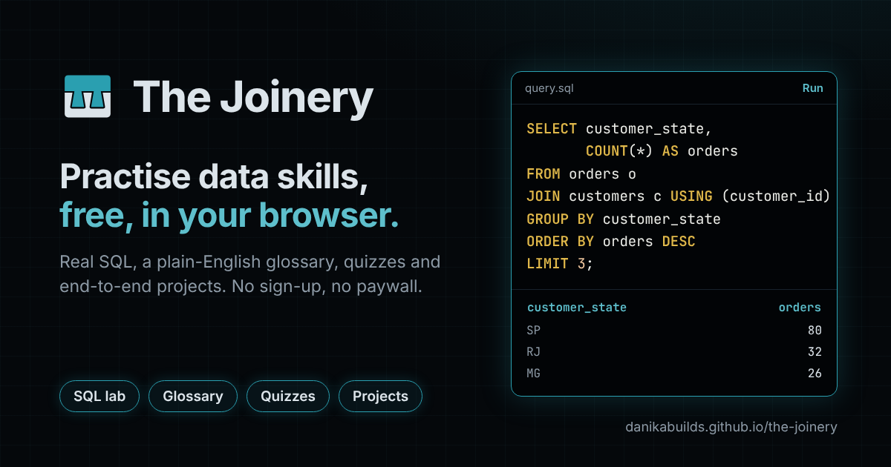

# The Joinery

Free data practice, piece by piece.

**Try it: [thejoinery.dev](https://thejoinery.dev)**

The Joinery is a free place to practise data skills in your browser. It is made for beginners and for anyone looking for their first data job. There is no sign-up, no paywall and nothing to install.

## What's inside

- **SQL lab.** 23 exercises on a practice shop database, with an editor, hints, instant checking and model answers. Wrong answers show which rows differ and the likely mistake, in plain language. After solving one, you can practise explaining your answer out loud, and translate your query to PostgreSQL, SQL Server, BigQuery or Snowflake.
- **Python practice.** Seven short guides that run in Google Colab: reading and cleaning a messy CSV, exploring with groupby, merging tables without double counting, dates, charts with Matplotlib, SQL inside Python with DuckDB, and turning a notebook into a script that combines many files.
- **Projects.** End-to-end briefs built around Just Now Deliveries, a fictional South African online store:
  - *Beginner Data Analytics:* profile and clean the data with Python, load it into DuckDB, build a star schema, answer business questions with SQL and build a dashboard.
  - *Intermediate Data Engineering:* turn the daily files into a pipeline that runs itself, with raw, staging and marts layers, dbt models and tests, and a scheduled run on GitHub Actions.
- **Glossary.** 163 data terms in seven areas (SQL, Python, Modelling, Pipelines, Business, Statistics, and BI and dashboards). Each has a plain meaning, an example, common mistakes and a sentence you can use in an interview. Some have small diagrams.
- **Quizzes.** Short multiple-choice quizzes by subject, with three levels, plus a review list that brings back exercises and terms you found hard.
- **Byte the beetle.** The mascot. He turns up with hints when something goes wrong.

Progress is saved in your own browser. Nothing is sent anywhere.

## Built with

| Part | Tools |
| --- | --- |
| Website | HTML, CSS and JavaScript, with no framework and no server |
| SQL lab | SQLite running in the browser via [sql.js](https://github.com/sql-js/sql.js), with the [CodeMirror 5](https://codemirror.net/5/) editor |
| Python practice | Python, pandas, Matplotlib and DuckDB, in Google Colab notebooks |
| Projects | Python, pandas, DuckDB, dbt Core, GitHub Actions and Power BI |
| Hosting | GitHub for the code, Cloudflare Pages for the site, GoatCounter for privacy-friendly visit counts |

All the practice data is synthetic, generated with Python.

## How it was built

I built The Joinery while broadening and deepening my own data skills. I designed the content, set up the hosting and domain, managed every change through Git and GitHub, and tested everything myself. Claude, an AI assistant, was my collaborator throughout: it helped me build faster and explain things more clearly. Every SQL answer, Python step and project result on the site has been run and checked.

## Run it on your own computer

The site needs a small local web server, because the SQL engine cannot load from a file opened directly.

- **VS Code:** install the "Live Server" extension, right-click `index.html` and choose "Open with Live Server".
- **Python:** in this folder, run `python -m http.server 8000`, then open <http://localhost:8000>.

## About the data

- **SQL lab:** a small synthetic shop database shaped like the public Olist e-commerce dataset (customers, orders, order items, products, sellers and payments), simplified to about 170 orders.
- **Projects and Python practice:** Just Now Deliveries, a synthetic South African online store with about 50,000 orders from 2024 to 2025, including deliberate data-quality problems to find and fix.

## How SQL answers are checked

Your query and the model answer both run against a fresh copy of the database, and the results are compared. Column names don't matter. Column order, values and, when the task asks for sorting, row order do. Numbers are compared to 2 decimal places.

## Feedback

Spotted a mistake or have an idea? Use "Report a mistake" at the bottom of any page, or email [danika.builds@gmail.com](mailto:danika.builds@gmail.com).

## Licence

Copyright © 2026 Danika Singh. All rights reserved. See `LICENSE`.

Third-party libraries keep their own licences: sql.js (MIT), CodeMirror 5 (MIT), and the Inter and JetBrains Mono fonts (SIL Open Font Licence).

Notes on how the site is organised and how to update it are in [MAINTAINING.md](MAINTAINING.md).
