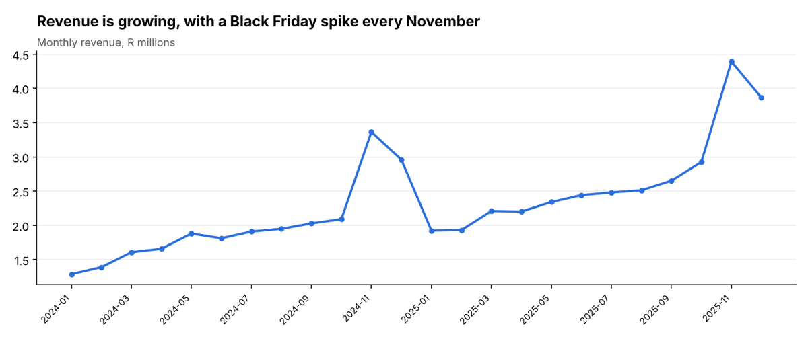
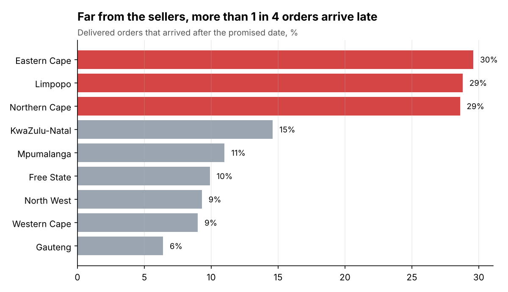
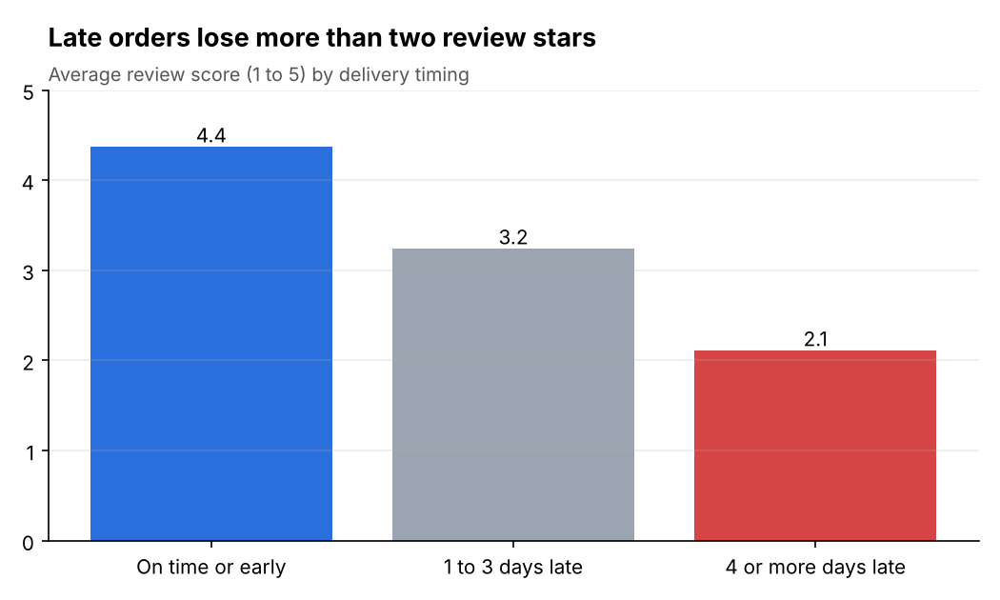
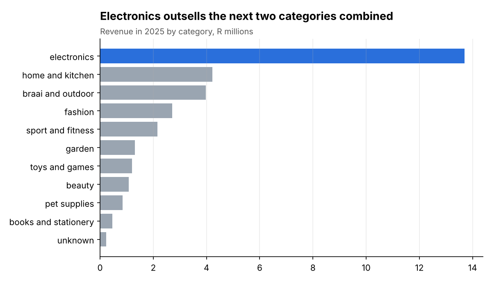

# Beginner Data Analytics: Just Now Deliveries

*Customers say we deliver "just now". Prove them wrong, or prove them right.*

## The brief

> **From Nomsa, Head of Operations:** We have grown fast, but my inbox is full of complaints about late parcels. Before our next planning meeting, I need three answers: are we really growing, where are deliveries failing, and does slow delivery hurt our reviews? Here is an export from our systems. Fair warning: it is a bit of a mess.

## At a glance

| | |
|---|---|
| Level | Beginner |
| Time | 6 to 8 hours, over a few sittings |
| Skills | Python scripting, Cleaning data with pandas, SQL in DuckDB, Star schema modelling, Business questions, Dashboards, A first pipeline |
| Tools | Python (free, open source), pandas (free, open source), DuckDB (free, open source), VS Code (free), Power BI Desktop (free, Windows only), matplotlib (free, open source) |

## Downloads

- [Project data](just-now-deliveries-data.zip) (3.0 MB): 7 CSV files and a data dictionary. Start here.
- [Model answers](just-now-deliveries-solution.zip) (12 KB): every script, for checking your work after you try.

*Just Now Deliveries is a made-up South African online store, and all of its data was generated by a computer program. Any resemblance to a real business is a coincidence.*

## 1. Set up your computer

*About 30 minutes*

You need three free tools. Install them from the official sites below, in this order.

- [Python](https://www.python.org/downloads/): The programming language. On Windows, tick **Add python.exe to PATH** on the first install screen.
- [Visual Studio Code](https://code.visualstudio.com/download): A free editor for writing and running code.
- [Python extension for VS Code](https://marketplace.visualstudio.com/items?itemName=ms-python.python): Lets VS Code run Python and spot mistakes as you type.
- [Jupyter extension for VS Code](https://marketplace.visualstudio.com/items?itemName=ms-toolsai.jupyter): Optional: lets you run code in small blocks and see results straight away.

### Make a project folder and a virtual environment

A virtual environment is a private box of Python packages for this one project, so it cannot clash with anything else on your computer. Download the data in step 2 first if you like: it already contains the project folder.

In VS Code, choose **File > Open Folder** and open your `just-now-deliveries` folder. Then open a terminal with **Terminal > New Terminal** and type:

```bash Windows (PowerShell)
python -m venv .venv
.venv\Scripts\Activate.ps1
pip install pandas duckdb matplotlib
```

```bash Mac or Linux
python3 -m venv .venv
source .venv/bin/activate
pip install pandas duckdb matplotlib
```

> **Tip:** On Windows, if PowerShell says running scripts is disabled, run `Set-ExecutionPolicy -Scope CurrentUser RemoteSigned`, answer Y, and try again.

> **You should see:** Your terminal line now starts with `(.venv)`. Then run `python -c "import pandas, duckdb, matplotlib; print('ready')"` and it prints `ready`.

### No install? Use Google Colab instead

On a work laptop or a computer you cannot install on, every Python step also works in [Google Colab](https://colab.research.google.com/), free in your browser with a Google account:

1. Open Colab and create a new notebook.
2. Select the folder icon on the left, then upload `just-now-deliveries-data.zip`.
3. In a code cell, run `!unzip -q just-now-deliveries-data.zip` then `%cd just-now-deliveries`.
4. Run `!pip install -q duckdb`. Colab already has pandas and matplotlib.
5. Write each script in a cell, or upload your .py files and run them with `!python clean.py`.

> **Tip:** Colab deletes your files when the session ends. Download anything you want to keep from the folder panel.

## 2. Get the data

*About 10 minutes*

Download [just-now-deliveries-data.zip](just-now-deliveries-data.zip) (3.0 MB) and unzip it. You get this layout:

```text Your project folder
just-now-deliveries/
  data/
    customers.csv
    sellers.csv
    products.csv
    orders.csv
    order_items.csv
    payments.csv
    reviews.csv
  DATA_DICTIONARY.md
  README.txt
```

Your scripts go in the `just-now-deliveries` folder, next to `data`. Open `DATA_DICTIONARY.md` in VS Code: it explains every column.

| File | Rows | One row is |
|---|---|---|
| customers.csv | 39 693 | a customer |
| sellers.csv | 120 | a shop selling through Just Now |
| products.csv | 419 | a product |
| orders.csv | 50 325 | an order (or so it claims: see step 3) |
| order_items.csv | 66 502 | one item in an order |
| payments.csv | 51 769 | one payment |
| reviews.csv | 38 910 | one review |

The tables link together through their IDs. An order belongs to a customer; it has one or more items; each item is a product sold by a seller. That is a [foreign key](https://danikabuilds.github.io/the-joinery/#/glossary/term/foreign-key) at work.

## 3. First look, with Python

*About 45 minutes*

Before you change anything, find out what you have. Create a file called `profile_data.py` and write a script that, for every CSV in `data`, prints:

- the number of rows and columns
- how many rows are exact duplicates
- for each column: how many values are missing, and how many distinct values there are

> **Tip:** Hint: read with `pd.read_csv(path, dtype=str)`. Reading everything as text means pandas cannot quietly change anything, such as an ID like 00042 losing its zeros. Then use `df.duplicated().sum()`, `df.isna().sum()` and `df.nunique()`.

Run it with `python profile_data.py`, then answer these from what it prints:

1. How many exact duplicate rows does orders.csv have?
2. South Africa has nine provinces. How many different spellings does customer_province have?
3. How many different values does order_status have, when there should be four?
4. Which column has the most missing values, and is that a problem?

<details>
<summary>Show the answers</summary>

- **310** duplicate rows in orders.csv.
- **63** spellings of 9 provinces: GP, gauteng, KZN, Kwazulu Natal, extra spaces and more.
- **16** versions of 4 statuses: delivered, Delivered, DELIVERED, "delivered " and so on.
- **review_comment**, at about 55% missing. That is fine: a comment is optional. Missing is only a problem when the value should be there.

</details>

<details>
<summary>Show the model script</summary>

```python profile_data.py
"""Step 3: a first look at every file.

Run it from the project folder:  python profile_data.py
It prints, for each CSV: how many rows and columns, each column's type,
how many values are missing, and how many rows are exact duplicates.
"""
from pathlib import Path
import pandas as pd

DATA = Path("data")


def profile(path):
    df = pd.read_csv(path, dtype=str)          # read everything as text first: nothing gets changed behind your back
    print(f"\n=== {path.name}: {len(df):,} rows, {df.shape[1]} columns ===")
    print(f"Exact duplicate rows: {df.duplicated().sum():,}")
    summary = pd.DataFrame({
        "missing": df.isna().sum(),
        "missing_%": (df.isna().mean() * 100).round(1),
        "distinct": df.nunique(),
        "example": df.iloc[0],
    })
    print(summary.to_string())


def main():
    for path in sorted(DATA.glob("*.csv")):
        profile(path)


if __name__ == "__main__":
    main()
```

</details>

## 4. Clean the data, with Python

*About 2 to 3 hours*

This is the biggest step, and the most realistic one. Create `clean.py`. It should read the raw files, fix the problems below, and save tidy copies in a new `clean` folder. Never change the raw files: if you make a mistake, you can always start again.

1. orders: remove exact duplicate rows.
2. orders: remove the test orders (their IDs start with TEST).
3. orders: make order_status lower case with no extra spaces.
4. orders: the date columns mix two formats, 2024-03-07 09:05:32 and 07/03/2024 09:05. Convert both into real dates.
5. customers and sellers: one spelling for each city and province (JHB, Joburg and Jozi are all Johannesburg).
6. products: tidy the categories, and put missing ones under `unknown`. A weight of 0 g is not real: set it to missing.
7. order_items: a price of 0 and freight of R9 999 are recording errors. Set them to missing, and keep a flag column so you can explain it later.
8. payments: one spelling for each payment type (credit_card, Card and CARD are all card).
9. reviews: drop scores outside 1 to 5. Some orders were reviewed twice: keep the latest review.

> **Tip:** Hints: write one function per table. `s.str.strip()` removes spaces at the ends, `.str.lower()` makes text lower case, and a Python dictionary with `.map()` turns nicknames into official names. For the two date formats, try `pd.to_datetime(s, format="%Y-%m-%d %H:%M:%S", errors="coerce")`, then the second format for whatever is still empty.

Make the script print what it changed. A cleaning report is how you explain your work to a manager, and it is a great thing to talk about in an interview. Related terms: [data quality](https://danikabuilds.github.io/the-joinery/#/glossary/term/data-quality), [deduplication](https://danikabuilds.github.io/the-joinery/#/glossary/term/deduplication), [NULL](https://danikabuilds.github.io/the-joinery/#/glossary/term/null).

<details>
<summary>Show the expected cleaning report</summary>

```text clean/cleaning_report.txt
orders       exact duplicate rows removed: 310
orders       test orders removed: 15
orders       status spellings 16 -> 4: 50,000
orders       order_purchase_ts: dates in day/month/year format converted: 3,510
orders       order_dispatched_ts: dates in day/month/year format converted: 3,404
orders       order_delivered_ts: dates in day/month/year format converted: 3,352
orders       delivered orders with no delivery date (flagged, kept): 180
customers    city spellings 149 -> 27, provinces 63 -> 9: 39,693
sellers      city spellings 33 -> 16, provinces 13 -> 4: 120
products     category spellings 26 -> 11, missing set to 'unknown': 6
products     zero weights set to missing: 6
order_items  items of removed (test) orders dropped: 15
order_items  zero prices set to missing (flagged): 150
order_items  freight values of R5,000 or more set to missing: 25
payments     payment type spellings 24 -> 4: 51,769
reviews      scores outside 1 to 5 removed: 12
reviews      older duplicate reviews removed (latest kept): 399
```

Small differences are fine if you made a different, sensible choice. What matters is that you can explain each one.

</details>

<details>
<summary>Show the model script</summary>

```python clean.py
"""Step 4: clean the raw files and save tidy copies in the clean/ folder.

Run it from the project folder:  python clean.py
Each function fixes one table and records what it changed, so you can explain every fix.
The raw files in data/ are never changed.
"""
from pathlib import Path
import pandas as pd

DATA, CLEAN = Path("data"), Path("clean")
report = []  # one line per fix, printed at the end and saved to clean/cleaning_report.txt


def log(table, message, count):
    report.append(f"{table:12s} {message}: {count:,}")


def read(name):
    # Read as text so pandas never guesses a type wrongly (for example, IDs that look like numbers).
    return pd.read_csv(DATA / f"{name}.csv", dtype=str, keep_default_na=False, na_values=[""])


def tidy_text(s):
    """Remove spaces at the start and end, and squeeze double spaces inside."""
    return s.str.strip().str.replace(r"\s+", " ", regex=True)


# ---------- places: one spelling for each city and province ----------
CITY_FIX = {
    "joburg": "Johannesburg", "jhb": "Johannesburg", "jozi": "Johannesburg",
    "cpt": "Cape Town", "kaapstad": "Cape Town",
    "dbn": "Durban", "ethekwini": "Durban",
    "pta": "Pretoria", "tshwane": "Pretoria",
    "port elizabeth": "Gqeberha", "pe": "Gqeberha",
    "bloem": "Bloemfontein", "nelspruit": "Mbombela",
}
PROVINCE_FIX = {
    "gp": "Gauteng", "gau": "Gauteng",
    "wc": "Western Cape", "w cape": "Western Cape",
    "kzn": "KwaZulu-Natal", "kwazulu natal": "KwaZulu-Natal",
    "ec": "Eastern Cape", "e cape": "Eastern Cape",
    "mp": "Mpumalanga",
    "fs": "Free State", "freestate": "Free State",
    "lp": "Limpopo", "lim": "Limpopo",
    "nw": "North West", "north-west": "North West",
    "nc": "Northern Cape", "n cape": "Northern Cape",
}
PROVINCES = ["Gauteng", "Western Cape", "KwaZulu-Natal", "Eastern Cape", "Mpumalanga",
             "Free State", "Limpopo", "North West", "Northern Cape"]


def fix_city(s):
    s = tidy_text(s)
    key = s.str.lower()
    # known nicknames first, then proper capitalisation for the rest ("cape town" -> "Cape Town")
    return key.map(CITY_FIX).fillna(s.str.title())


def fix_province(s):
    s = tidy_text(s)
    key = s.str.lower()
    official = {p.lower(): p for p in PROVINCES}
    return key.map(PROVINCE_FIX).fillna(key.map(official))


def clean_places(df, prefix, table):
    city, prov = f"{prefix}_city", f"{prefix}_province"
    before_city, before_prov = df[city].nunique(), df[prov].nunique()
    df[city] = fix_city(df[city])
    df[prov] = fix_province(df[prov])
    log(table, f"city spellings {before_city} -> {df[city].nunique()}, provinces {before_prov} -> {df[prov].nunique()}", len(df))
    unknown = df[prov].isna().sum()
    if unknown:
        log(table, "WARNING province not recognised", unknown)
    return df


# ---------- dates: two formats in the same column ----------
def parse_dates(s):
    """Most dates look like 2024-03-07 09:05:32. Some look like 07/03/2024 09:05 (day first).
    Try the main format, then the second format for whatever is left."""
    first = pd.to_datetime(s, format="%Y-%m-%d %H:%M:%S", errors="coerce")
    second = pd.to_datetime(s, format="%d/%m/%Y %H:%M", errors="coerce")
    return first.fillna(second)


# ---------- one function per table ----------
def clean_customers():
    df = read("customers")
    df = clean_places(df, "customer", "customers")
    df["signup_date"] = pd.to_datetime(df["signup_date"])
    return df


def clean_sellers():
    return clean_places(read("sellers"), "seller", "sellers")


def clean_products():
    df = read("products")
    before = df["product_category"].nunique()
    df["product_category"] = tidy_text(df["product_category"]).str.lower()
    missing = df["product_category"].isna().sum()
    df["product_category"] = df["product_category"].fillna("unknown")
    log("products", f"category spellings {before} -> {df['product_category'].nunique()}, missing set to 'unknown'", missing)
    df["product_weight_g"] = pd.to_numeric(df["product_weight_g"])
    zero = (df["product_weight_g"] == 0).sum()
    df.loc[df["product_weight_g"] == 0, "product_weight_g"] = pd.NA  # a weight of 0 g is not real: treat it as unknown
    log("products", "zero weights set to missing", zero)
    return df


def clean_orders():
    df = read("orders")
    n = len(df)
    df = df.drop_duplicates()
    log("orders", "exact duplicate rows removed", n - len(df))

    test = df["order_id"].str.startswith("TEST")
    log("orders", "test orders removed", test.sum())
    df = df[~test].copy()

    before = df["order_status"].nunique()
    df["order_status"] = tidy_text(df["order_status"]).str.lower()
    log("orders", f"status spellings {before} -> {df['order_status'].nunique()}", len(df))

    for col in ["order_purchase_ts", "order_dispatched_ts", "order_delivered_ts"]:
        other = df[col].str.contains("/", na=False).sum()
        df[col] = parse_dates(df[col])
        log("orders", f"{col}: dates in day/month/year format converted", other)
    df["order_estimated_delivery_date"] = pd.to_datetime(df["order_estimated_delivery_date"])

    # Delivered orders with no delivery date: keep them (the sale happened), but flag them,
    # so delivery-time questions can leave them out.
    df["delivery_date_missing"] = (df["order_status"] == "delivered") & df["order_delivered_ts"].isna()
    log("orders", "delivered orders with no delivery date (flagged, kept)", df["delivery_date_missing"].sum())
    return df


def clean_items(valid_orders):
    df = read("order_items")
    for col in ["price", "freight_value"]:
        df[col] = pd.to_numeric(df[col])
    df["order_item_id"] = pd.to_numeric(df["order_item_id"])

    orphans = ~df["order_id"].isin(valid_orders)
    log("order_items", "items of removed (test) orders dropped", orphans.sum())
    df = df[~orphans].copy()

    # A price of 0 is a recording error, not a free gift. Flag it and leave it out of revenue.
    df["price_missing"] = df["price"] == 0
    df.loc[df["price_missing"], "price"] = pd.NA
    log("order_items", "zero prices set to missing (flagged)", df["price_missing"].sum())

    # Freight of R9,999 on a small parcel is a placeholder, not a real charge.
    outlier = df["freight_value"] >= 5000
    df.loc[outlier, "freight_value"] = pd.NA
    log("order_items", "freight values of R5,000 or more set to missing", outlier.sum())
    return df


def clean_payments(valid_orders):
    df = read("payments")
    df["payment_value"] = pd.to_numeric(df["payment_value"])
    df["payment_installments"] = pd.to_numeric(df["payment_installments"])
    df["payment_sequential"] = pd.to_numeric(df["payment_sequential"])
    before = df["payment_type"].nunique()
    key = tidy_text(df["payment_type"]).str.lower().str.replace("-", "_").str.replace(" ", "_")
    df["payment_type"] = key.replace({"credit_card": "card", "bank_transfer": "eft", "gift_voucher": "voucher"})
    log("payments", f"payment type spellings {before} -> {df['payment_type'].nunique()}", len(df))
    df = df[df["order_id"].isin(valid_orders)]
    return df


def clean_reviews(valid_orders):
    df = read("reviews")
    df["review_score"] = pd.to_numeric(df["review_score"])
    df["review_date"] = pd.to_datetime(df["review_date"])

    bad = ~df["review_score"].between(1, 5)
    log("reviews", "scores outside 1 to 5 removed", bad.sum())
    df = df[~bad]

    # Some orders were reviewed twice. Keep the latest review for each order.
    n = len(df)
    df = df.sort_values("review_date").drop_duplicates("order_id", keep="last")
    log("reviews", "older duplicate reviews removed (latest kept)", n - len(df))
    return df[df["order_id"].isin(valid_orders)]


def main():
    CLEAN.mkdir(exist_ok=True)
    report.clear()
    orders = clean_orders()
    valid = set(orders["order_id"])
    tables = {
        "customers": clean_customers(),
        "sellers": clean_sellers(),
        "products": clean_products(),
        "orders": orders,
        "order_items": clean_items(valid),
        "payments": clean_payments(valid),
        "reviews": clean_reviews(valid),
    }
    for name, df in tables.items():
        df.to_csv(CLEAN / f"{name}.csv", index=False)
    text = "\n".join(report)
    (CLEAN / "cleaning_report.txt").write_text(text + "\n")
    print(text)
    print(f"\nClean files saved in {CLEAN.resolve()}")


if __name__ == "__main__":
    main()
```

</details>

> **You should see:** You have a `clean` folder with seven CSV files. clean/orders.csv has 50 000 rows, and every province column has exactly 9 values.

## 5. Load the data into DuckDB

*About 20 minutes*

DuckDB is a database in a single file on your computer, with nothing to set up. Loading the clean files into it means you can use SQL from here on, the same SQL as in the SQL lab.

Create `load.py`. For each clean CSV, run `CREATE OR REPLACE TABLE name AS SELECT * FROM read_csv_auto('clean/name.csv')`. DuckDB reads the file and picks the column types for you.

- [DuckDB documentation](https://duckdb.org/docs/installation/): Installation and the Python guide.

<details>
<summary>Show the model script</summary>

```python load.py
"""Step 5: load the clean files into a DuckDB database file called just_now.duckdb.

Run it from the project folder:  python load.py
DuckDB is a database that lives in one file on your computer. There is no server to set up.
"""
from pathlib import Path
import duckdb

CLEAN = Path("clean")
DB = "just_now.duckdb"
TABLES = ["customers", "sellers", "products", "orders", "order_items", "payments", "reviews"]


def main():
    con = duckdb.connect(DB)
    for t in TABLES:
        # read_csv_auto looks at the file and picks sensible column types (dates, numbers, text)
        con.execute(f"CREATE OR REPLACE TABLE {t} AS SELECT * FROM read_csv_auto('{(CLEAN / (t + '.csv')).as_posix()}')")
        n = con.execute(f"SELECT COUNT(*) FROM {t}").fetchone()[0]
        print(f"loaded {t:12s} {n:>7,} rows")
    con.close()


if __name__ == "__main__":
    main()
```

</details>

> **You should see:** Running `python load.py` prints seven tables, and a file called `just_now.duckdb` appears in your folder: customers 39 693, order_items 66 487, orders 50 000, payments 51 769, products 419, reviews 38 499, sellers 120 rows.

## 6. Model the data

*About 1 to 2 hours*

Raw tables are shaped for storing data, not for answering questions. Build a [star schema](https://danikabuilds.github.io/the-joinery/#/glossary/term/star-schema): one [fact table](https://danikabuilds.github.io/the-joinery/#/glossary/term/fact-table) with the numbers, and [dimension tables](https://danikabuilds.github.io/the-joinery/#/glossary/term/dimension-table) to slice them by.

- `fact_orders`: [one row per order](https://danikabuilds.github.io/the-joinery/#/glossary/term/grain). Columns: order, customer, seller, order date, status, item count, revenue, freight, promised date, delivered date, days late, is late, a delivery timing group, days to deliver and the review score.
- `dim_customer`, `dim_product`: one row per customer and per product.
- `dim_date`: one row per day for 2024 and 2025, with year, month and weekday. Every chart then uses the same calendar.

> **Tip:** Hint: add up the items per order in a [CTE](https://danikabuilds.github.io/the-joinery/#/glossary/term/cte) first, then join that to orders. If you join the item rows straight to orders and then sum, you get a [join fan-out](https://danikabuilds.github.io/the-joinery/#/glossary/term/fan-out): orders with three items are counted three times. Use `date_diff('day', promised, delivered)` for days late.

Write the SQL in `model.sql`, and a small `model.py` that runs it. Also save each model table as a CSV in `model_export`: you need those for Power BI in step 8.

> **You should see:** fact_orders has exactly 50 000 rows, one per order. Check with `SELECT COUNT(*) - COUNT(DISTINCT order_id) FROM fact_orders`: it must be 0.

<details>
<summary>Show the model SQL</summary>

```sql model.sql
-- Step 6: model the data for analysis.
-- One fact table with ONE ROW PER ORDER (that is its grain), plus dimension tables to slice it by.

-- Customers: who bought, and where they live
CREATE OR REPLACE TABLE dim_customer AS
SELECT customer_id, customer_city, customer_province, signup_date
FROM customers;

-- Products: what was sold
CREATE OR REPLACE TABLE dim_product AS
SELECT product_id, product_name, product_category, product_weight_g
FROM products;

-- Dates: one row per day, so every chart can use the same calendar
CREATE OR REPLACE TABLE dim_date AS
SELECT
  d::DATE                          AS date,
  year(d)                          AS year,
  month(d)                         AS month,
  strftime(d, '%Y-%m')             AS year_month,
  strftime(d, '%B')                AS month_name,
  dayname(d)                       AS day_name,
  isodow(d) IN (6, 7)              AS is_weekend
FROM range(DATE '2024-01-01', DATE '2026-01-01', INTERVAL 1 DAY) AS t(d);

-- The fact table: one row per order, with the numbers the business asks about
CREATE OR REPLACE TABLE fact_orders AS
WITH items AS (
  SELECT
    order_id,
    COUNT(*)                     AS item_count,
    SUM(price)                   AS revenue,        -- items with a missing price are left out (SUM skips NULL)
    SUM(freight_value)           AS freight,
    MIN(seller_id)               AS seller_id,      -- every order in this store ships from one seller
    BOOL_OR(price_missing)       AS has_missing_price
  FROM order_items
  GROUP BY order_id
),
latest_review AS (
  SELECT order_id, review_score FROM reviews
)
SELECT
  o.order_id,
  o.customer_id,
  i.seller_id,
  CAST(o.order_purchase_ts AS DATE)                         AS order_date,
  o.order_status,
  i.item_count,
  i.revenue,
  i.freight,
  i.has_missing_price,
  o.order_estimated_delivery_date                           AS promised_date,
  CAST(o.order_delivered_ts AS DATE)                        AS delivered_date,
  date_diff('day', o.order_estimated_delivery_date, CAST(o.order_delivered_ts AS DATE)) AS days_late,
  CASE WHEN o.order_delivered_ts IS NULL THEN NULL
       ELSE CAST(o.order_delivered_ts AS DATE) > o.order_estimated_delivery_date END AS is_late,
  CASE
    WHEN o.order_delivered_ts IS NULL THEN NULL
    WHEN CAST(o.order_delivered_ts AS DATE) <= o.order_estimated_delivery_date THEN '1. On time or early'
    WHEN date_diff('day', o.order_estimated_delivery_date, CAST(o.order_delivered_ts AS DATE)) <= 3 THEN '2. 1 to 3 days late'
    ELSE '3. 4 or more days late'
  END                                                       AS delivery_timing,
  date_diff('hour', o.order_purchase_ts, o.order_delivered_ts) / 24.0 AS days_to_deliver,
  r.review_score
FROM orders o
JOIN items i USING (order_id)
LEFT JOIN latest_review r USING (order_id);
```

```python model.py
"""Step 6: build the analysis model (model.sql) inside just_now.duckdb.

Run it from the project folder:  python model.py
"""
from pathlib import Path
import duckdb

DB = "just_now.duckdb"


def main():
    con = duckdb.connect(DB)
    con.execute(open("model.sql", encoding="utf-8").read())
    for t in ["dim_customer", "dim_product", "dim_date", "fact_orders"]:
        n = con.execute(f"SELECT COUNT(*) FROM {t}").fetchone()[0]
        print(f"built {t:13s} {n:>7,} rows")
    # a quick check that the grain is right: exactly one row per order
    dupes = con.execute("SELECT COUNT(*) - COUNT(DISTINCT order_id) FROM fact_orders").fetchone()[0]
    print("one row per order:", "yes" if dupes == 0 else f"NO, {dupes} extra rows")
    # copies of the model as CSV files, for Power BI or Excel (Get data > Text/CSV)
    Path("model_export").mkdir(exist_ok=True)
    for t in ["dim_customer", "dim_product", "dim_date", "fact_orders"]:
        con.execute(f"COPY {t} TO 'model_export/{t}.csv' (HEADER)")
    print("model tables saved as CSV in model_export/ (for Power BI)")
    con.close()


if __name__ == "__main__":
    main()
```

</details>

## 7. Answer the business questions

*About 2 hours*

Now the questions the head of operations asked. Write each query in `questions.sql`, try it, and write down the answer in one sentence before you look. Revenue means the price of items on orders that were not cancelled.

### Q1. Are we growing?

Revenue and number of orders per month, then the growth from 2024 to 2025. *Uses: [Growth rate](https://danikabuilds.github.io/the-joinery/#/glossary/term/growth-rate), [seasonality](https://danikabuilds.github.io/the-joinery/#/glossary/term/seasonality), [LAG](https://danikabuilds.github.io/the-joinery/#/glossary/term/lag-lead).*

<details>
<summary>Show the Q1 answer</summary>

```sql SQL
-- Q1. Are we growing? Revenue and orders per month.
SELECT
  strftime(order_date, '%Y-%m')         AS month,
  COUNT(*)                              AS orders,
  ROUND(SUM(revenue), 0)                AS revenue
FROM fact_orders
WHERE order_status <> 'cancelled'
GROUP BY month
ORDER BY month;

-- Q1 (part two). Growth from 2024 to 2025.
WITH y AS (
  SELECT year(order_date) AS yr, SUM(revenue) AS revenue, COUNT(*) AS orders
  FROM fact_orders
  WHERE order_status <> 'cancelled'
  GROUP BY yr
)
SELECT
  yr,
  ROUND(revenue, 0)                                                      AS revenue,
  orders,
  ROUND(revenue / orders, 2)                                             AS avg_order_value,
  ROUND(100.0 * (revenue / LAG(revenue) OVER (ORDER BY yr) - 1), 1)      AS revenue_growth_pct
FROM y
ORDER BY yr;
```

| Year | Revenue | Orders | Average order | Growth |
|---|---|---|---|---|
| 2 024 | R23 936 964 | 20 965 | R1 142 | nan |
| 2 025 | R31 872 840 | 27 635 | R1 153 | 33.2 |

**What it means:** Revenue grew **33%**, from R23 936 964 in 2024 to R31 872 840 in 2025. The average order barely moved, so the growth came from more orders, not bigger ones. November is the biggest month every year: Black Friday took revenue from R2 924 914 in October 2025 to R4 391 796 in November.

</details>

### Q2. What sells?

Revenue by category in 2025, with each category's share of the total. *Uses: [window functions](https://danikabuilds.github.io/the-joinery/#/glossary/term/window-function) (the share uses `SUM(...) OVER ()`).*

<details>
<summary>Show the Q2 answer</summary>

```sql SQL
-- Q2. What sells? Revenue by category in 2025, with each category's share.
SELECT
  p.product_category                                         AS category,
  ROUND(SUM(i.price), 0)                                     AS revenue,
  ROUND(100.0 * SUM(i.price) / SUM(SUM(i.price)) OVER (), 1) AS share_pct
FROM order_items i
JOIN orders o     USING (order_id)
JOIN dim_product p USING (product_id)
WHERE o.order_status <> 'cancelled'
  AND year(o.order_purchase_ts) = 2025
GROUP BY category
ORDER BY revenue DESC;
```

| Category | Revenue | Share |
|---|---|---|
| electronics | R13 697 911 | 43.0% |
| home and kitchen | R4 225 668 | 13.3% |
| braai and outdoor | R3 972 891 | 12.5% |
| fashion | R2 705 130 | 8.5% |
| sport and fitness | R2 148 892 | 6.7% |
| garden | R1 314 230 | 4.1% |
| toys and games | R1 199 478 | 3.8% |
| beauty | R1 073 088 | 3.4% |
| pet supplies | R845 777 | 2.7% |
| books and stationery | R460 230 | 1.4% |
| unknown | R229 544 | 0.7% |

**What it means:** Electronics brings in **43%** of revenue, more than the next two categories combined. That is a strength and a risk: a problem with electronics stock or a big electronics supplier would hit the whole business.

</details>

### Q3. Where are deliveries failing?

For delivered orders: the share that arrived after the promised date, by the customer's province. *Uses: [joins](https://danikabuilds.github.io/the-joinery/#/glossary/term/left-join).*

<details>
<summary>Show the Q3 answer</summary>

```sql SQL
-- Q3. Where are deliveries failing? Share of delivered orders that arrived after the promised date.
SELECT
  c.customer_province                       AS province,
  COUNT(*)                                  AS delivered_orders,
  ROUND(100.0 * AVG(f.is_late::INT), 1)     AS late_pct,
  ROUND(AVG(f.days_to_deliver), 1)          AS avg_days_to_deliver
FROM fact_orders f
JOIN dim_customer c USING (customer_id)
WHERE f.order_status = 'delivered'
  AND f.is_late IS NOT NULL                 -- leaves out the 180 orders with no delivery date
GROUP BY province
ORDER BY late_pct DESC;
```

| Province | Delivered | Late | Average days |
|---|---|---|---|
| Eastern Cape | 3 854 | 29.6% | 6.8 |
| Limpopo | 2 278 | 28.8% | 7.1 |
| Northern Cape | 1 325 | 28.6% | 8 |
| KwaZulu-Natal | 7 871 | 14.6% | 5.8 |
| Mpumalanga | 2 927 | 11.0% | 5.2 |
| Free State | 2 209 | 9.9% | 5.6 |
| North West | 1 828 | 9.3% | 5.2 |
| Western Cape | 8 106 | 9.0% | 4.8 |
| Gauteng | 16 496 | 6.4% | 4.4 |

**What it means:** Distance is the problem. Most sellers are in Gauteng and the Western Cape, so Gauteng customers wait 4.4 days and only 6% of orders are late, while in the Eastern Cape it is **30%**. The promised dates in far provinces are too optimistic.

</details>

### Q4. Does slow delivery hurt our reviews?

Average review score, and the share of 1 or 2 star reviews, by delivery timing. *Uses: [CASE](https://danikabuilds.github.io/the-joinery/#/glossary/term/case).*

<details>
<summary>Show the Q4 answer</summary>

```sql SQL
-- Q4. Does slow delivery hurt our reviews? Average score by how late the order was.
SELECT
  delivery_timing                       AS delivery,   -- a column we built in the model, so the rule lives in one place
  COUNT(*)                              AS reviews,
  ROUND(AVG(review_score), 2)           AS avg_score,
  ROUND(100.0 * AVG((review_score <= 2)::INT), 1) AS pct_1_or_2_stars
FROM fact_orders
WHERE order_status = 'delivered'
  AND review_score IS NOT NULL
  AND delivery_timing IS NOT NULL
GROUP BY delivery
ORDER BY delivery;
```

| Delivery | Reviews | Average score | 1 or 2 stars |
|---|---|---|---|
| 1. On time or early | 31 964 | 4.37 | 5.9% |
| 2. 1 to 3 days late | 3 998 | 3.24 | 28.4% |
| 3. 4 or more days late | 616 | 2.11 | 68.2% |

**What it means:** Yes, sharply. On-time orders average **4.4** stars. Orders 4 or more days late average **2.1**, and 68% of those reviews are 1 or 2 stars. Even 1 to 3 days late costs more than a star. (This shows the two move together; it does not prove lateness is the only cause. See [correlation versus causation](https://danikabuilds.github.io/the-joinery/#/glossary/term/correlation-causation).)

</details>

### Q5. Do customers come back?

Of customers who ordered, the share with two or more orders, and their share of revenue. *Uses: [repeat purchase rate](https://danikabuilds.github.io/the-joinery/#/glossary/term/repeat-purchase-rate), [retention](https://danikabuilds.github.io/the-joinery/#/glossary/term/retention).*

<details>
<summary>Show the Q5 answer</summary>

```sql SQL
-- Q5. Do customers come back? Share of customers with two or more orders, and their share of revenue.
WITH per_customer AS (
  SELECT customer_id, COUNT(*) AS orders, SUM(revenue) AS revenue
  FROM fact_orders
  WHERE order_status <> 'cancelled'
  GROUP BY customer_id
)
SELECT
  COUNT(*)                                                         AS customers,
  SUM((orders >= 2)::INT)                                          AS repeat_customers,
  ROUND(100.0 * AVG((orders >= 2)::INT), 1)                        AS repeat_pct,
  ROUND(100.0 * SUM(CASE WHEN orders >= 2 THEN revenue END) / SUM(revenue), 1) AS repeat_revenue_pct
FROM per_customer;
```

| Customers who ordered | Came back | Repeat rate | Their share of revenue |
|---|---|---|---|
| 33 710 | 6 197 | 18.4% | 42.5% |

**What it means:** Only **18%** of customers came back, but they brought in **42%** of revenue. Keeping customers is worth a lot, and Q4 shows late deliveries are a likely reason people do not return.

</details>

### Q6. Detective question: when and where did it go most wrong?

The month and province with the highest late rate (only where there were 100 or more deliveries). *Uses: [GROUP BY](https://danikabuilds.github.io/the-joinery/#/glossary/term/group-by) with [HAVING](https://danikabuilds.github.io/the-joinery/#/glossary/term/where-vs-having).*

<details>
<summary>Show the Q6 answer</summary>

```sql SQL
-- Q6. Detective question: which month and province had the worst late rate? (Only cells with 100+ deliveries.)
SELECT
  strftime(f.order_date, '%Y-%m')           AS month,
  c.customer_province                       AS province,
  COUNT(*)                                  AS delivered_orders,
  ROUND(100.0 * AVG(f.is_late::INT), 1)     AS late_pct
FROM fact_orders f
JOIN dim_customer c USING (customer_id)
WHERE f.order_status = 'delivered' AND f.is_late IS NOT NULL
GROUP BY month, province
HAVING COUNT(*) >= 100
ORDER BY late_pct DESC
LIMIT 5;
```

| Month | Province | Delivered | Late |
|---|---|---|---|
| 2025-04 | KwaZulu-Natal | 340 | 83.5% |
| 2025-10 | Eastern Cape | 195 | 36.4% |
| 2025-11 | Northern Cape | 106 | 35.8% |
| 2024-12 | Eastern Cape | 211 | 35.5% |
| 2025-04 | Limpopo | 102 | 35.3% |

**What it means:** **KwaZulu-Natal in April 2025: 84% late**, far worse than anything else. A one-off spike like this points to an event, such as a courier hub backlog, not a slow seller. Your next move would be to ask operations what happened that month.

</details>

### Q7. How do customers pay?

Share of payments, average amount and average instalments by payment type. *Uses: [aggregate functions](https://danikabuilds.github.io/the-joinery/#/glossary/term/aggregate-function).*

<details>
<summary>Show the Q7 answer</summary>

```sql SQL
-- Q7. How do customers pay? Share of payments and average amount by payment type.
SELECT
  payment_type,
  COUNT(*)                                          AS payments,
  ROUND(100.0 * COUNT(*) / SUM(COUNT(*)) OVER (), 1) AS share_pct,
  ROUND(AVG(payment_value), 2)                      AS avg_amount,
  ROUND(AVG(payment_installments), 2)               AS avg_instalments
FROM payments
GROUP BY payment_type
ORDER BY payments DESC;
```

| Type | Payments | Share | Average amount | Average instalments |
|---|---|---|---|---|
| card | 32 646 | 63.1% | R1 254 | 2.39 |
| instant eft | 9 158 | 17.7% | R1 256 | 1 |
| eft | 5 933 | 11.5% | R1 214 | 1 |
| voucher | 4 032 | 7.8% | R706 | 1 |

**What it means:** Card is **63%** of payments, and card buyers often spread big orders over instalments. Vouchers are mostly used for part of an order, so their average amount is much lower.

</details>

To run all of them in one go and save each answer as a CSV in `output`, write `analyse.py`.

<details>
<summary>Show the model script</summary>

```python analyse.py
"""Step 7: run every business question in questions.sql, print the answers and save each one as a CSV in output/.

Run it from the project folder:  python analyse.py
"""
from pathlib import Path
import duckdb

DB = "just_now.duckdb"
OUT = Path("output")


def read_questions(path="questions.sql"):
    """Split questions.sql into {name: sql} using the '-- name:' lines."""
    queries, name, lines = {}, None, []
    for line in open(path, encoding="utf-8"):
        if line.startswith("-- name:"):
            if name:
                queries[name] = "".join(lines)
            name, lines = line.split(":", 1)[1].strip(), []
        elif name:
            lines.append(line)
    if name:
        queries[name] = "".join(lines)
    return queries


def main():
    OUT.mkdir(exist_ok=True)
    con = duckdb.connect(DB, read_only=True)
    for name, sql in read_questions().items():
        df = con.execute(sql).df()
        df.to_csv(OUT / f"{name}.csv", index=False)
        print(f"\n--- {name} ---")
        print(df.to_string(index=False))
    con.close()


if __name__ == "__main__":
    main()
```

</details>

## 8. Build the dashboard

*About 1 to 2 hours*

One page, for the head of operations. Each chart answers one question, and its title says the answer, not just the topic. See [dashboard design](https://danikabuilds.github.io/the-joinery/#/glossary/term/dashboard-design) and [chart choice](https://danikabuilds.github.io/the-joinery/#/glossary/term/chart-choice).

- Top row: four headline numbers: revenue, orders, late %, average review score.
- A line chart of revenue by month (Q1).
- A bar chart of late % by province, sorted, with the worst provinces highlighted (Q3).
- A column chart of average review by delivery timing (Q4).
- Optional: revenue by category (Q2).

### Route A: Power BI Desktop (Windows)

- [Get Power BI Desktop](https://learn.microsoft.com/en-us/power-bi/fundamentals/desktop-get-the-desktop): Microsoft's official page. Free, but Windows only and not open source.

1. Open Power BI Desktop, select **Get data > Text/CSV**, and load each file in `model_export`.
2. In **Model view**, drag `fact_orders[customer_id]` onto `dim_customer[customer_id]`, and `fact_orders[order_date]` onto `dim_date[date]`.
3. Create the measures below with **New measure**, then build the visuals.

```dax Measures (DAX)
Revenue = CALCULATE ( SUM ( fact_orders[revenue] ), fact_orders[order_status] <> "cancelled" )

Orders = CALCULATE ( COUNTROWS ( fact_orders ), fact_orders[order_status] <> "cancelled" )

Late % =
DIVIDE (
    CALCULATE ( COUNTROWS ( fact_orders ), fact_orders[order_status] = "delivered", fact_orders[is_late] = TRUE () ),
    CALCULATE ( COUNTROWS ( fact_orders ), fact_orders[order_status] = "delivered", NOT ISBLANK ( fact_orders[is_late] ) )
)

Average review = AVERAGE ( fact_orders[review_score] )
```

> **You should see:** With no filters: Late % for Gauteng shows 6.4%, and Revenue for 2025 shows R31 872 840. If yours differ, check the status filter in the measures. Related: [measures versus columns](https://danikabuilds.github.io/the-joinery/#/glossary/term/measure-vs-column), [filter context](https://danikabuilds.github.io/the-joinery/#/glossary/term/filter-context).

### Route B: Python charts (any computer)

No Windows? Draw the same charts with [matplotlib](https://matplotlib.org/). Create `charts.py` that reads the CSVs in `output` and saves each chart as an image. This is what yours could look like:









<details>
<summary>Show the model script</summary>

```python charts.py
"""Step 8 (Python route): draw the four dashboard charts as PNG images in output/.

Run it from the project folder after analyse.py:  python charts.py
"""
from pathlib import Path
import pandas as pd
import matplotlib
matplotlib.use("Agg")                     # draw to files, no window needed
import matplotlib.pyplot as plt

OUT = Path("output")
BLUE, GREY, RED = "#2A6FDB", "#9AA5B1", "#D64545"


def style(ax, title, subtitle):
    ax.set_title(title, loc="left", fontsize=13, fontweight="bold", pad=22)
    ax.text(0, 1.02, subtitle, transform=ax.transAxes, fontsize=9.5, color="#555")
    ax.spines[["top", "right"]].set_visible(False)
    ax.grid(axis="y", alpha=.25)


def revenue_trend():
    df = pd.read_csv(OUT / "q1_monthly_revenue.csv")
    fig, ax = plt.subplots(figsize=(10, 4.2))
    ax.plot(df["month"], df["revenue"] / 1e6, color=BLUE, linewidth=2, marker="o", markersize=4)
    style(ax, "Revenue is growing, with a Black Friday spike every November", "Monthly revenue, R millions")
    ax.set_xticks(range(0, len(df), 2), df["month"][::2], rotation=45, ha="right", fontsize=8)
    fig.tight_layout(); fig.savefig(OUT / "chart_revenue_trend.png", dpi=150); plt.close(fig)


def late_by_province():
    df = pd.read_csv(OUT / "q3_late_by_province.csv").sort_values("late_pct")
    fig, ax = plt.subplots(figsize=(8, 4.6))
    colours = [RED if v >= 20 else GREY for v in df["late_pct"]]
    ax.barh(df["province"], df["late_pct"], color=colours)
    for y, v in enumerate(df["late_pct"]):
        ax.text(v + .5, y, f"{v:.0f}%", va="center", fontsize=9)
    style(ax, "Far from the sellers, more than 1 in 4 orders arrive late", "Delivered orders that arrived after the promised date, %")
    ax.grid(axis="x", alpha=.25); ax.grid(axis="y", visible=False)
    fig.tight_layout(); fig.savefig(OUT / "chart_late_by_province.png", dpi=150); plt.close(fig)


def reviews_vs_lateness():
    df = pd.read_csv(OUT / "q4_reviews_vs_lateness.csv")
    labels = [d.split(". ", 1)[1] for d in df["delivery"]]
    fig, ax = plt.subplots(figsize=(7, 4.2))
    bars = ax.bar(labels, df["avg_score"], color=[BLUE, GREY, RED])
    for b, v in zip(bars, df["avg_score"]):
        ax.text(b.get_x() + b.get_width() / 2, v + .05, f"{v:.1f}", ha="center", fontsize=10)
    ax.set_ylim(0, 5)
    style(ax, "Late orders lose more than two review stars", "Average review score (1 to 5) by delivery timing")
    fig.tight_layout(); fig.savefig(OUT / "chart_reviews_vs_lateness.png", dpi=150); plt.close(fig)


def top_categories():
    df = pd.read_csv(OUT / "q2_top_categories.csv").sort_values("revenue")
    fig, ax = plt.subplots(figsize=(8, 4.6))
    ax.barh(df["category"].str.replace("_", " "), df["revenue"] / 1e6, color=GREY)
    ax.barh(df["category"].str.replace("_", " ").iloc[-1:], df["revenue"].iloc[-1:] / 1e6, color=BLUE)
    style(ax, "Electronics outsells the next two categories combined", "Revenue in 2025 by category, R millions")
    ax.grid(axis="x", alpha=.25); ax.grid(axis="y", visible=False)
    fig.tight_layout(); fig.savefig(OUT / "chart_top_categories.png", dpi=150); plt.close(fig)


def main():
    revenue_trend(); late_by_province(); reviews_vs_lateness(); top_categories()
    print("Charts saved in", OUT.resolve())


if __name__ == "__main__":
    main()
```

</details>

## 9. Run it all with one command

*About 30 minutes*

Right now you run five scripts by hand. Write `run_all.py` that runs clean, load, model, analyse and charts in order, prints how long each took, and stops with a clear message if one fails. This is a small [data pipeline](https://danikabuilds.github.io/the-joinery/#/glossary/term/data-pipeline): the same idea data engineers schedule to run every night. Because each step replaces its output instead of adding to it, running it twice gives the same result. That is called [idempotency](https://danikabuilds.github.io/the-joinery/#/glossary/term/idempotency).

> **Tip:** Hint: give each script a `main()` function and end it with `if __name__ == "__main__": main()`. Then `run_all.py` can import each script and call its `main()`.

<details>
<summary>Show the model script</summary>

```python run_all.py
"""Step 9: run the whole pipeline with one command.

Run it from the project folder:  python run_all.py
clean -> load -> model -> analyse -> charts. If any step fails, it stops and says which one.
This is the same idea as the pipelines data engineers schedule to run every night.
"""
import time
import clean, load, model, analyse, charts

STEPS = [("clean", clean.main), ("load", load.main), ("model", model.main),
         ("analyse", analyse.main), ("charts", charts.main)]


def main():
    started = time.time()
    for name, step in STEPS:
        print(f"\n===== {name} =====")
        t = time.time()
        try:
            step()
        except Exception as e:
            print(f"\nThe pipeline stopped at the '{name}' step: {e}")
            raise SystemExit(1)
        print(f"({name} took {time.time() - t:.1f} s)")
    print(f"\nAll done in {time.time() - started:.1f} seconds.")


if __name__ == "__main__":
    main()
```

</details>

> **You should see:** Delete the `clean`, `output` and `model_export` folders and `just_now.duckdb`, then run `python run_all.py`. Everything comes back in a few seconds, with the same answers.

## 10. Why it matters, and how to talk about it

*About 30 minutes*

Numbers only matter when they change a decision. Here is what a real online retailer would do with your answers:

| Finding | Decision it supports |
|---|---|
| Revenue up 33%, from more orders | Plan courier capacity and stock for more volume, especially for November. |
| Eastern Cape, Limpopo and the Northern Cape: about 3 in 10 orders late | Promise realistic dates in far provinces, or recruit sellers or a warehouse closer to them. |
| Late orders drop from 4.4 to 2.1 stars | Treat on-time delivery as a customer experience goal, not just a logistics number. |
| 18% of customers bring 42% of revenue | Invest in bringing customers back, starting by fixing delivery for them. |
| KZN, April 2025: 84% late | Set an alert for when a province's late rate jumps, so the next backlog is caught in days, not months. |

### Say it in an interview

Practise these out loud. They follow situation, action, result:

- "I took seven raw files from an online store, about fifty thousand orders, and cleaned them with Python. I fixed 63 spellings of nine provinces, two date formats in one column and duplicate rows, and the script prints a report of every fix."
- "I modelled the data as a star schema with one row per order, and I checked the grain before analysing, so nothing was double-counted."
- "The key finding was that deliveries to far provinces were late about three times as often as in Gauteng, and late orders lost more than two review stars. Repeat customers were 18% of buyers but 42% of revenue, so fixing delivery protects the most valuable customers."
- "I wrapped it in one pipeline script, so the whole analysis reruns in seconds when new data arrives."

## 11. Take it further

*About as long as you like*

- Add a `fact_order_items` table (one row per item) so Power BI can show revenue by category and by seller.
- Rank sellers by late rate. Are a few slow sellers dragging the average down? (Hint: there are.)
- Group customers by when they first bought and track how many come back each month: a [cohort analysis](https://danikabuilds.github.io/the-joinery/#/glossary/term/cohort-analysis).
- Split customers by recency, frequency and spend: [RFM segmentation](https://danikabuilds.github.io/the-joinery/#/glossary/term/rfm).
- Put your project on GitHub with a short README: the question, what you did, the answer and one chart. Then link it from your CV and LinkedIn.

### Try it on real data

- [Brazilian e-commerce public dataset by Olist (Kaggle)](https://www.kaggle.com/datasets/olistbr/brazilian-ecommerce): Real orders from a Brazilian marketplace, with a very similar shape to this project. Free with a Kaggle account. Check the licence on the page before you publish your work.

---

Part of [The Joinery](https://danikabuilds.github.io/the-joinery/), free data practice in your browser.
