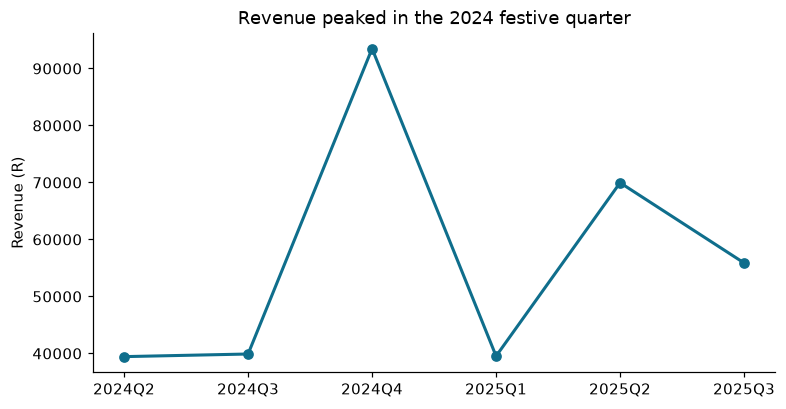
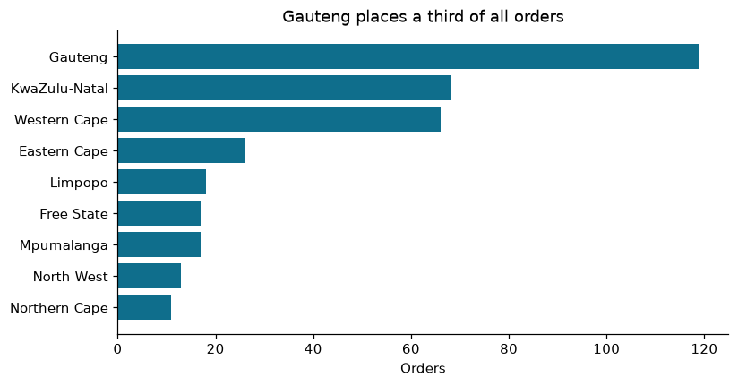
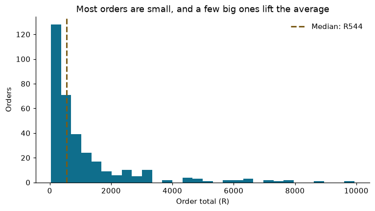

# Charts with Matplotlib

*Python practice. About 25 minutes, nothing to install and nothing to download.*

## Before you start

A chart is there to make one point quickly. You will make the three charts analysts use most, each with a title that says what the reader should notice. See [choosing a chart](https://thejoinery.dev/#/glossary/term/chart-choice).

**Run it in Google Colab** (free, needs a Google account): [open the ready-made notebook](https://colab.research.google.com/github/danikabuilds/the-joinery/blob/main/projects/python-charts/python-charts.ipynb), then run each cell with Shift + Enter. Or open a blank notebook at [colab.research.google.com](https://colab.research.google.com/) and paste each step in as you go.

The code reads the practice files straight from The Joinery, so there is nothing to download or upload.

## 1. Get the numbers ready

*About 4 minutes*

Matplotlib draws charts, and pandas gets the numbers ready. Here, revenue for each quarter of the year.

```python Python
import pandas as pd
import matplotlib.pyplot as plt

BASE = "https://thejoinery.dev/projects/python-data/"
headers = {"User-Agent": "Mozilla/5.0"}   # some websites block Python's default request; this sends a browser-style name
orders = pd.read_csv(BASE + "orders.csv", parse_dates=["order_date", "delivered_date"], storage_options=headers)
orders["quarter"] = orders["order_date"].dt.to_period("Q").astype(str)
quarterly = orders.groupby("quarter")["order_total"].sum().round(2)
print(quarterly)
```

> **Tip:** The `headers` line tells the website the request comes from a browser. Without it, the site's host turns Python away with an `HTTP Error 403: Forbidden`. You only need it for files on websites, not for files on your own computer.

```text Output
quarter
2024Q1    10587.26
2024Q2    39438.27
2024Q3    39897.53
2024Q4    93485.93
2025Q1    39531.32
2025Q2    69955.44
2025Q3    55876.82
2025Q4    46305.26
Name: order_total, dtype: float64
```

## 2. Leave out part periods

*About 3 minutes*

The data starts on 15 January 2024 and stops on 30 November 2025, so the first and last quarters are missing weeks. Drawn on a chart, they would look like a slump that never happened. Keep only the full quarters. `.loc["2024Q2":"2025Q3"]` picks the rows from one label to another, including both.

```python Python
full_quarters = quarterly.loc["2024Q2":"2025Q3"]
print(full_quarters)
```

```text Output
quarter
2024Q2    39438.27
2024Q3    39897.53
2024Q4    93485.93
2025Q1    39531.32
2025Q2    69955.44
2025Q3    55876.82
Name: order_total, dtype: float64
```

## 3. A line chart for change over time

*About 5 minutes*

`plt.subplots()` gives you a figure (the whole picture) and an axes (the chart inside it), called `fig` and `ax` by habit. You then draw on `ax` and set its title and labels.

```python Python
fig, ax = plt.subplots(figsize=(8, 4))
ax.plot(full_quarters.index, full_quarters.values, color="#0F6E8C", linewidth=2, marker="o")
ax.set_title("Revenue peaked in the 2024 festive quarter")
ax.set_ylabel("Revenue (R)")
ax.spines[["top", "right"]].set_visible(False)
plt.show()
```



The title states the point, so nobody has to work it out. Removing the top and right borders (the spines) makes the chart quieter.

## 4. A sorted bar chart for comparing groups

*About 4 minutes*

For categories, use bars, sorted so the order means something. `barh` draws them across the page, which leaves room for long names. Sorting smallest first puts the biggest bar at the top.

```python Python
counts = orders["province"].value_counts().sort_values()
fig, ax = plt.subplots(figsize=(8, 4))
ax.barh(counts.index, counts.values, color="#0F6E8C")
ax.set_title("Gauteng places a third of all orders")
ax.set_xlabel("Orders")
ax.spines[["top", "right"]].set_visible(False)
plt.show()
```



## 5. A histogram for the shape of the data

*About 5 minutes*

A histogram puts values into buckets (`bins`) and counts each bucket. It shows what a typical value is and how spread out the rest are. The dashed line marks the median, and the f-string in its label turns the number into text such as `R544`.

```python Python
median = orders["order_total"].median()
fig, ax = plt.subplots(figsize=(8, 4))
ax.hist(orders["order_total"].dropna(), bins=30, color="#0F6E8C")
ax.axvline(median, color="#7A5B17", linestyle="--", linewidth=2, label=f"Median: R{median:,.0f}")
ax.set_title("Most orders are small, and a few big ones lift the average")
ax.set_xlabel("Order total (R)")
ax.set_ylabel("Orders")
ax.legend(frameon=False)
ax.spines[["top", "right"]].set_visible(False)
plt.show()
```



Most orders are small, with a long tail of big ones to the right. That shape is called [skewed](https://thejoinery.dev/#/glossary/term/skewness), and it is why the median is a better "typical" order than the mean here.

## 6. Save a chart

*About 2 minutes*

`savefig` writes the chart to a picture file you can put in a report or slide. `dpi=150` makes it sharp, and `bbox_inches="tight"` trims the empty border.

```python Python
fig.savefig("order_totals.png", dpi=150, bbox_inches="tight")
print("Saved")
```

```text Output
Saved
```

In Colab, the file appears in the folder panel on the left, where you can download it.

## What you just did

| Chart | Use it for |
|---|---|
| Line | Change over time, with whole periods only |
| Sorted bar | Comparing groups |
| Histogram | The shape of one number column |

**Say it in an interview:** "I pick the chart from the question, title it with the finding rather than the topic, and leave out part periods so the trend is honest."

**Next:** [SQL inside Python with DuckDB](https://thejoinery.dev/#/projects/python-duckdb).

---

Part of [The Joinery](https://thejoinery.dev/), free data practice in your browser.
